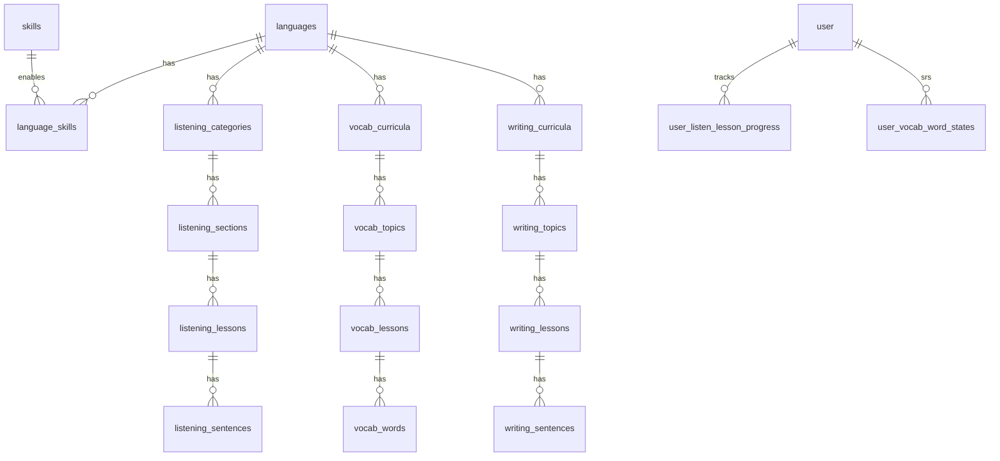

# Daily Lexis — Database Design

## Đề xuất stack dữ liệu

| Thành phần | Lựa chọn | Lý do |
|------------|----------|--------|
| **Database** | **PostgreSQL 16+** | Quan hệ rõ (ngôn ngữ → kỹ năng → chủ đề → bài), progress/join, leaderboard, Better Auth adapter chính thức |
| **ORM** | **Drizzle ORM** | Type-safe, migration, tích hợp Better Auth + Hono |
| **Cache (tuỳ chọn)** | Redis | Session hot path, leaderboard snapshot, rate limit |

**Không chọn NoSQL làm store chính:** progress theo câu/từ, SRS vocabulary, và aggregation leaderboard map tự nhiên hơn trên SQL. Có thể dùng object storage (S3/R2) cho **audio**, DB chỉ lưu URL + metadata.

---

## Phân tích màn hình → entity

### 1. Landing — chọn ngôn ngữ (EN / ZH / JP)

- `languages`: mã ISO, tên, native_name, flag/icon, `is_active`, `sort_order`
- UI locale (tiếng Việt) ≠ ngôn ngữ học → `ui_locale` trên user profile, không trùng `languages`

### 2. Hub ngôn ngữ — 3 kỹ năng

- `skills`: `dictation` | `vocabulary` | `writing` (enum/table)
- `language_skills`: bật/tắt skill theo ngôn ngữ, mô tả marketing

### 3–5. Listen (nghe / dictation) — EN · ZH · JP

**Chi tiết + map API:** `docs/design/2026-11-04-learning-content-schema-en-zh-jp.md` §1.

| Tier | Bảng | Ghi chú |
|------|------|--------|
| Catalog | `listening_categories` | List topic: slug, name, `levels[]`, `lesson_count` |
| Section | `listening_sections` | `section-en-short-stories-1`, Section 1… |
| Lesson | `listening_lessons` | uuid, slug, level, audio R2 key, `template_type`, `path` |
| Câu | `listening_sentences` | position, start/end ms, transcript, metadata jsonb (ipa, properNames) |

Progress (phase 2 — **MVP done**): `user_listen_lesson_progress`, `user_settings`; API merge guest, admin read, FTS — `docs/design/2026-11-05-listening-progress-settings-admin-search.md`. **Backlog sau MVP:** `docs/design/2026-11-05-listen-post-mvp-backlog.md`. Optional: `user_listen_sentence_attempts`. Timeline câu = `listening_sentences.start_ms` / `end_ms` (content, đã có bảng). Chi tiết field §1.4 `2026-11-04-learning-content-schema-en-zh-jp.md`.

### 6–8. Vocabulary — EN · ZH · JP

**Chi tiết:** `docs/design/2026-11-04-learning-content-schema-en-zh-jp.md` §2.

| Tier | Bảng |
|------|------|
| Level | `vocab_curricula` — `(language_id, level_code)` e.g. A1, HSK1, N5 |
| Topic | `vocab_topics` — slug `communication-and-everyday-language` |
| Lesson | `vocab_lessons` — `lesson-01`, title, description |
| Từ | `vocab_words` — term, ipa, meaning_vi, examples, collocations |
| Quiz | `distractors jsonb` trên `vocab_words` (MVP) |

**Vocab MVP schema/API:** `src/modules/vocab/`, `user_vocab_lesson_progress`, `user_vocab_weak_items`, `pnpm db:seed:vocab`. Phạm vi EN / admin API-only / TTS: `docs/design/2026-11-05-vocab-scope-conventions.md`. Backlog: `docs/design/2026-11-05-vocab-post-mvp-backlog.md`.

### 8b. Vocab — luồng bài & progress (phase 2)

- `lesson_activity_types`: familiarize | flashcard | matching | quiz | quick_review
- `vocabulary_lesson_activities`: `lesson_id`, activity_type, `order_index`, config jsonb
- SRS / mastery: `user_vocabulary_item_states`: user, item, ease, interval, due_at, status (new/learning/mastered)
- **Ôn nhanh — từ sai/yếu (đề xuất):** `user_vocabulary_weak_items`
  - `user_id`, `vocabulary_item_id`, `lesson_id` (bài phát sinh lỗi)
  - `weak_source`: `flashcard_again` | `matching_wrong` | `main_quiz_wrong` | `carried_from_lesson`
  - `review_flashcard_required`: boolean — `true` nếu Học lại / ghép sai / carry; `false` nếu chỉ sai quiz chính (đã “Đã nhớ” flashcard)
  - `status`: `active` | `cleared` | `carried` — cleared sau quiz xác nhận đúng; carried khi còn yếu sang bài kế (`target_lesson_id` nullable)
  - `created_at`, `cleared_at`, optional `source_activity` (flashcard | matching | quiz)
  - Unique partial index gợi ý: `(user_id, vocabulary_item_id, lesson_id)` where `status = 'active'`
  - **Thứ tự ôn nhanh (UI):** lấy mọi row active ( + carry vào `lesson_id` hiện tại) → sort ổn định → **lượt 1:** flashcard cho `review_flashcard_required = true` → **lượt 2:** một câu quiz / item (full queue). Chi tiết hành vi: `docs/design/2026-11-04-vocab-lesson-story-json.md`.

### 9. Handbook (Cẩm nang) — blog / bài viết

- `handbook_collections`: `language_id`, slug, overline, title, description, `sort_order`, `is_published`
- `handbook_posts`: `collection_id`, slug, `sort_order`, category, `reading_time_minutes`, title, excerpt, summary, `published_at`, featured, `body jsonb` (`blocks[]`: `text` \| `numberedList`), `is_published`
- Shape: `docs/design/2026-11-04-handbook-blog-content-json.md`, seed `docs/design/fixtures/handbook-posts-en.sample.json`
- Views (later): `user_handbook_post_views`

### 10. Grammar — tab ngữ pháp (EN, mock JSON)

- `grammar_modules`: `language_id`, slug (`moduleId`), title, `cefr_level`, `sort_order`
- `grammar_units`: `module_id`, slug (`unitId`), title, `sort_order`
- `grammar_points`: `unit_id`, `type` (`lesson` | `content`), title, `intro`, `example`, `content_plain`, `body jsonb` (full point + `sections[]`), `sort_order`
- Payload shape: `docs/design/2026-11-04-grammar-tab-content-json.md`, seed `docs/design/fixtures/grammar-units-en.sample.json`
- Progress (phase sau): `user_grammar_point_progress` — user, point, `completed_at`

### 11. Writing — EN · ZH · JP

**Chi tiết:** `docs/design/2026-11-04-learning-content-schema-en-zh-jp.md` §3.

| Tier | Bảng |
|------|------|
| Level | `writing_curricula` |
| Topic | `writing_topics` — e.g. `daily-life` |
| Lesson | `writing_lessons` — `script_modes` jsonb (Han/Pinyin, Standard/Kana) |
| Câu | `writing_sentences` — `prompt_vi`, `target_default`, `targets_by_mode`, `pronunciation` jsonb (ipa / pinyin / romaji) |

Progress (MVP EN): `user_writing_lesson_progress`, API + learner UI — `docs/design/2026-11-05-writing-scope-conventions.md`, `pnpm db:seed:writing`.

### 12. Chung — auth, gamification, thông báo

- **Better Auth** (Drizzle): `user`, `session`, `account`, `verification` — theo schema plugin
- `user_profiles`: display_name, avatar_url, `ui_locale`, `preferred_language_id`
- `user_daily_activity`: `(user_id, activity_date)`, `active_seconds` — thời gian học/ngày (TZ profile)
- `user_streaks`: `current_streak`, `longest_streak`, `last_qualified_date` (ngày ≥ **15 phút** = 1 ngày streak)
- `user_stats`: total_xp, updated_at (streak đọc từ daily activity hoặc `user_streaks`)
- `leaderboard_entries`: materialized view hoặc bảng snapshot theo period (weekly/all)
- `notifications`: user_id, type, payload jsonb, read_at

---

## Sơ đồ quan hệ (rút gọn)

**ER đầy đủ (content):** `docs/design/2026-11-04-learning-content-schema-en-zh-jp.md` §6.

---

## Index & query patterns

- Slug lookup: unique `(language_id, slug)` trên collection/topic/lesson
- Danh sách section: `(collection_id, order_index)`
- Progress dashboard: `(user_id, lesson_id)` PK trên bảng progress
- Leaderboard: index `(period, xp DESC)`
- Full-text (tuỳ chọn): `tsvector` trên `dictation_lessons.title`, `vocabulary_lessons.title`

---

## Ghi chú triển khai

1. **Hono API** + **Next.js App Router**: auth qua Better Auth; API routes proxy hoặc shared package `@dailytaka/db`.
2. **Migration-first**: mọi thay đổi schema qua Drizzle migrate, không sửa tay production.
3. **Content CMS** (phase sau): admin CRUD collections/lessons; MVP seed SQL/JSON.
4. UI theo `design/*.design.md` (bạn bổ sung); implement với shadcn/ui + Animate UI — agent **không** tự thiết kế ngoài spec.
5. **Listen / Vocab / Write (EN·ZH·JP):** spec cột + API mapping → `docs/design/2026-11-04-learning-content-schema-en-zh-jp.md`. Phase 2 user/streak/settings: cùng file §8.

## Phase 2 (outline — chưa implement)

User, từ sai, thời gian học, streak, settings — bảng stub trong `2026-11-04-learning-content-schema-en-zh-jp.md` §8; mở rộng SRS/weak items vocab giữ nguyên mục §8 doc cũ (`user_vocabulary_weak_items`).
