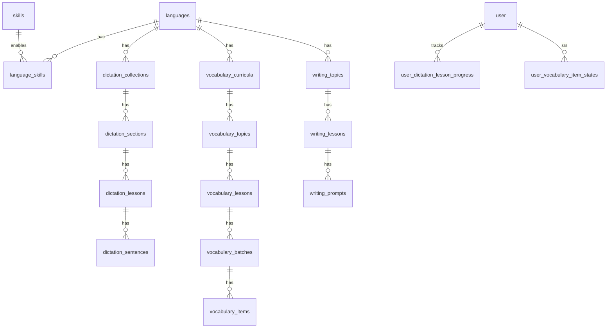

# Daily Lexis — Database Design

## Đề xuất stack dữ liệu

| Thành phần | Lựa chọn | Lý do |
|------------|----------|--------|
| **Database** | **PostgreSQL 16+** | Quan hệ rõ (ngôn ngữ → kỹ năng → chủ đề → bài), progress/join, leaderboard, Better Auth adapter chính thức |
| **ORM** | **Drizzle ORM** | Type-safe, migration, tích hợp Better Auth + Hono |
| **Cache (tuỳ chọn)** | Redis | Session hot path, leaderboard snapshot, rate limit |

**Không chọn NoSQL làm store chính:** progress theo câu/từ, SRS vocabulary, và aggregation leaderboard map tự nhiên hơn trên SQL. Có thể dùng object storage (S3/R2) cho **audio**, DB chỉ lưu URL + metadata.

---

## Phân tích màn hình → entity

### 1. Landing — chọn ngôn ngữ (EN / ZH / JP)

- `languages`: mã ISO, tên, native_name, flag/icon, `is_active`, `sort_order`
- UI locale (tiếng Việt) ≠ ngôn ngữ học → `ui_locale` trên user profile, không trùng `languages`

### 2. Hub ngôn ngữ — 3 kỹ năng

- `skills`: `dictation` | `vocabulary` | `writing` (enum/table)
- `language_skills`: bật/tắt skill theo ngôn ngữ, mô tả marketing

### 3. Dictation — danh mục (Short Stories, TOEIC, …)

- `dictation_collections`: `language_id`, slug, title, description, icon_key, `level_min`, `level_max` (A1–C2), `lesson_count` (denormalized/cache)
- Breadcrumb: Language → Dictation → Collection

### 4. Dictation — sections + danh sách bài

- `dictation_sections`: `collection_id`, `order_index`, title (Section 1…)
- `dictation_lessons`: `section_id`, slug, title, `cefr_level`, `sentence_count`, `sort_order`, optional `difficulty_stars`
- Progress: `user_dictation_lesson_progress` (completed sentences, last_position, completed_at)

### 5. Dictation — bài học (First Snow Fall, 21 câu)

- `dictation_sentences`: `lesson_id`, `order_index`, `audio_url`, `transcript`, `start_ms`, `end_ms`, `proper_nouns` (jsonb string[])
- `user_dictation_sentence_attempts`: user, sentence, input, is_correct, created_at (analytics + resume)
- Chế độ “toàn bộ transcript”: derive từ aggregate sentences hoặc `dictation_lessons.full_transcript`

### 6. Vocabulary — chọn CEFR (A1–C2)

- `cefr_levels`: code A1…C2, sort
- `vocabulary_curricula`: `language_id` + level (unique)

### 7. Vocabulary — chủ đề + bài (Everyday Communication…)

- `vocabulary_topics`: `curriculum_id`, slug, title, `lesson_count`
- `vocabulary_lessons`: `topic_id`, slug, title, `word_count`, `estimated_minutes`, description
- `vocabulary_batches`: `lesson_id`, `order_index` (batch preview 10 từ)
- `vocabulary_items`: `batch_id`, lemma, translation_vi, `audio_url`, `sort_order`, optional context_sentence

### 8. Vocabulary — luồng bài (overview + 5 bước)

- `lesson_activity_types`: familiarize | flashcard | matching | quiz | quick_review
- `vocabulary_lesson_activities`: `lesson_id`, activity_type, `order_index`, config jsonb
- SRS / mastery: `user_vocabulary_item_states`: user, item, ease, interval, due_at, status (new/learning/mastered)
- **Ôn nhanh — từ sai/yếu (đề xuất):** `user_vocabulary_weak_items`
  - `user_id`, `vocabulary_item_id`, `lesson_id` (bài phát sinh lỗi)
  - `weak_source`: `flashcard_again` | `matching_wrong` | `main_quiz_wrong` | `carried_from_lesson`
  - `review_flashcard_required`: boolean — `true` nếu Học lại / ghép sai / carry; `false` nếu chỉ sai quiz chính (đã “Đã nhớ” flashcard)
  - `status`: `active` | `cleared` | `carried` — cleared sau quiz xác nhận đúng; carried khi còn yếu sang bài kế (`target_lesson_id` nullable)
  - `created_at`, `cleared_at`, optional `source_activity` (flashcard | matching | quiz)
  - Unique partial index gợi ý: `(user_id, vocabulary_item_id, lesson_id)` where `status = 'active'`
  - **Thứ tự ôn nhanh (UI):** lấy mọi row active ( + carry vào `lesson_id` hiện tại) → sort ổn định → **lượt 1:** flashcard cho `review_flashcard_required = true` → **lượt 2:** một câu quiz / item (full queue). Chi tiết hành vi: `docs/design/2026-11-04-vocab-lesson-story-json.md`.

### 9. Writing — A1 → topic → lesson (Cooking Breakfast, 12 câu)

- `writing_topics`: `language_id`, `cefr_level`, slug, title
- `writing_lessons`: `topic_id`, slug, title, `question_count`
- `writing_prompts`: `lesson_id`, `order_index`, prompt_vi, answer_en, `word_lengths` (jsonb cho UI mask `* ****`)

### 10. Chung — auth, gamification, thông báo

- **Better Auth** (Drizzle): `user`, `session`, `account`, `verification` — theo schema plugin
- `user_profiles`: display_name, avatar_url, `ui_locale`, `preferred_language_id`
- `user_stats`: total_xp, streak_days, updated_at
- `leaderboard_entries`: materialized view hoặc bảng snapshot theo period (weekly/all)
- `notifications`: user_id, type, payload jsonb, read_at

---

## Sơ đồ quan hệ (rút gọn)

---

## Index & query patterns

- Slug lookup: unique `(language_id, slug)` trên collection/topic/lesson
- Danh sách section: `(collection_id, order_index)`
- Progress dashboard: `(user_id, lesson_id)` PK trên bảng progress
- Leaderboard: index `(period, xp DESC)`
- Full-text (tuỳ chọn): `tsvector` trên `dictation_lessons.title`, `vocabulary_lessons.title`

---

## Ghi chú triển khai

1. **Hono API** + **Next.js App Router**: auth qua Better Auth; API routes proxy hoặc shared package `@dailytaka/db`.
2. **Migration-first**: mọi thay đổi schema qua Drizzle migrate, không sửa tay production.
3. **Content CMS** (phase sau): admin CRUD collections/lessons; MVP seed SQL/JSON.
4. UI theo `design/*.design.md` (bạn bổ sung); implement với shadcn/ui + Animate UI — agent **không** tự thiết kế ngoài spec.
