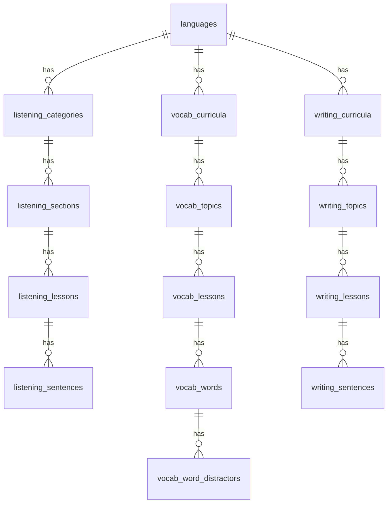

# Learning content schema — Listen · Vocab · Write (EN / ZH / JP)

Thiết kế DB **nội dung học** (phase 1). Phase 2: user, progress, từ sai, streak, settings — chỉ liệt kê stub cuối doc.

Payload tham chiếu từ API hiện tại (list category → section lessons → lesson detail; vocab level → topics → lesson words; write level → topics → sentences).

---

## Shared core

### `languages`

| Column | Type | Notes |
|--------|------|--------|
| `id` | uuid PK | |
| `code` | text UNIQUE | `en`, `zh`, `jp` — hub + `language_code` API |
| `name` | text | English |
| `native_name` | text | Tiếng Anh, 中文, 日本語 |
| `is_active` | boolean | |
| `sort_order` | smallint | |

### `proficiency_levels`

Một bảng cho mọi hệ (CEFR / HSK / JLPT).

| Column | Type | Notes |
|--------|------|--------|
| `id` | uuid PK | |
| `language_id` | uuid FK → languages | |
| `code` | text | `A1`, `HSK1`, `N5` — API `level` |
| `framework` | text | `cefr` \| `hsk` \| `jlpt` |
| `sort_order` | smallint | |

UNIQUE `(language_id, code)`.

### `skills`

| Column | Type | Notes |
|--------|------|--------|
| `id` | smallserial PK | |
| `code` | text UNIQUE | `listen`, `vocab`, `write` |

(`dictation` trong UI = skill `listen`.)

---

## 1. Listen (nghe — chép / dictation)

### 1.1 Category catalog (trang `/en/listen`)

**API:** `{ next, rows: [{ id, name, slug, levels[], sort_order, lessonCount, description }] }`

### `listening_categories`

| Column | Type | API field |
|--------|------|-----------|
| `id` | uuid PK | `id` (e.g. `category-en-short-stories` hoặc uuid — chọn **uuid PK** + `external_id` text nếu cần import) |
| `language_id` | uuid FK | suy từ `language_code` |
| `slug` | text | `slug` — `short-stories` |
| `name` | text | `name` |
| `description` | text nullable | `description` |
| `sort_order` | int | `sort_order` |
| `lesson_count` | int | `lessonCount` — cache, recompute từ lessons |
| `levels` | text[] | `levels` — CEFR tags gắn category |
| `is_published` | boolean | |

UNIQUE `(language_id, slug)`.

### 1.2 Section + lazy list bài (mở accordion section)

**API rows:** `id`, `path`, `slug`, `level`, `title`, `section_id`, `category_*`, `display_order`, `sentence_count`, `template_type`, `section_title`, `section_number`, …

### `listening_sections`

| Column | Type | Notes |
|--------|------|--------|
| `id` | text PK hoặc uuid | API `section_id`: `section-en-short-stories-1` |
| `category_id` | uuid FK → listening_categories | |
| `section_number` | int | `section_number` / `section_order` |
| `title` | text | `Section 1` |
| `sort_order` | int | |

UNIQUE `(category_id, section_number)`.

### `listening_lessons`

| Column | Type | API field |
|--------|------|-----------|
| `id` | uuid PK | `id` |
| `section_id` | text/uuid FK | `section_id` |
| `category_id` | uuid FK | denormalize — filter nhanh |
| `language_id` | uuid FK | `language_code` |
| `slug` | text | `first-snow-fall` |
| `title` | text | `First Snow Fall` |
| `level_code` | text | `A1` — FK logic → proficiency_levels |
| `display_order` | int | `display_order` |
| `sentence_count` | int | cache |
| `duration_ms` | int nullable | detail |
| `description` | text nullable | |
| `template_type` | text | `audio` \| `youtube` — `template_type` |
| `youtube_video_id` | text nullable | |
| `audio_storage_key` | text nullable | `audio_key` / `media.key` |
| `media_type` | text | `r2_audio`, … |
| `thumbnail_storage_key` | text nullable | |
| `metadata` | jsonb | `metadata` import (importMode, sourceFilename, …) |
| `path` | text | `/lessons/{category}/{section}/{slug}` — cache URL app |
| `updated_at` | timestamptz | |
| `is_published` | boolean | |

UNIQUE `(section_id, slug)`. Index `(category_id, section_id, display_order)`.

**List endpoint:** JOIN category + section → trả đúng shape `rows[]` (có thể VIEW `listening_lesson_catalog`).

**Query `level`:** `GET .../sections/:sectionId/lessons?level=A1` — lọc theo `level_code` (mặc định all).

**HTTP (public, no auth):** prefix `/v1/languages/{en|zh|jp}/listening` — xem `src/modules/listening/listening.routes.ts`.

**Admin CUD:** `/v1/admin/languages/{code}/listening` — `ADMIN_API_KEY` (`Authorization: Bearer` hoặc `x-admin-api-key`); Better Auth admin role sau. POST/PATCH/DELETE category, section, lesson; PUT `/lessons/:id/sentences`; PATCH/DELETE sentence.

**Seed JSON (EN / ZH / JP — cùng shape):** `languageCode`, `category` (id, slug, name, levels[], cover?), `sections[]` (id, sectionNumber, title, access), `lessons[]` (id, slug, title, levelCode, displayOrder, audioStorageKey?, durationMs?, metadata?, `sentences[]`: position, startMs, endMs, transcript, metadata). ZH/JP khác `language_code`, slug/title nội dung, `level_code` (HSK/JLPT), id prefix `category-zh-*` / `category-jp-*`.

### 1.3 Lesson detail + sentences

**API `lesson`:** + `audio_url`, `media`, `sentences[]`, `nextLesson`.

### `listening_sentences`

| Column | Type | API field |
|--------|------|-----------|
| `id` | uuid PK | sentence `id` |
| `lesson_id` | uuid FK → listening_lessons | |
| `position` | int | `position` (1-based) |
| `start_ms` | int | |
| `end_ms` | int | |
| `transcript` | text | |
| `metadata` | jsonb | `{ ipa, confidence, properNames }` |

UNIQUE `(lesson_id, position)`. Index `(lesson_id, position)`.

**`nextLesson`:** query `display_order + 1` cùng `section_id`, không cần bảng riêng.

**Audio bytes:** Postgres chỉ `audio_storage_key` (vd. `listening/en/lessons/{lessonId}/audio.mp3`). Bytes trong **MinIO/S3** (`STORAGE_*`, `docker compose` service `minio`). Seed: `FIRST_SNOW_AUDIO_SOURCE` → `putObject`, không commit MP3 vào repo. **Stream:** `GET /v1/languages/{code}/listening/audio/{key...}` (Range + CORS); detail trả `audioUrl` qua `buildListeningAudioUrl`.

**Chia timeline theo câu (SRT):** mỗi row `listening_sentences` = một câu với `start_ms` / `end_ms` (milliseconds trên file audio lesson). Player seek theo câu; **không** cần bảng riêng “trạng thái audio” — đó là **nội dung**, không phải progress user.

**Import legacy (package/SRT):** map vào `listening_lessons.metadata` (`importMode`, `sourceFilename`, `alignmentProvider`, …), `audio_storage_key` / `media.key`, bulk insert `listening_sentences` với đủ 21 câu như payload mẫu.

### 1.4 Trạng thái lesson theo user (progress) — **chưa migration**

Payload kiểu `lessons[]` trên section/card (khi đã login):

```json
{
  "lessonId": "uuid",
  "starCount": 0,
  "isStarred": false,
  "isCompleted": false,
  "completionCount": 0,
  "completedSentenceCount": 0,
  "completionCycleActive": true
}
```

| API field | Bảng / cột (đề xuất) |
|-----------|----------------------|
| `lessonId` | `user_listen_lesson_progress.lesson_id` → FK `listening_lessons.id` |
| `isCompleted` | `status = 'completed'` (hoặc derive từ `completed_sentence_count >= sentence_count`) |
| `completedSentenceCount` | `completed_sentence_count` |
| `completionCount` | `completion_count` — số lần hoàn thành full bài (replay) |
| `completionCycleActive` | `completion_cycle_active` — đang trong một vòng dictation (reset khi user “làm lại”) |
| `isStarred` / `starCount` | `is_starred`, `star_count` (0–5) — **rating user**, khác `listening_lessons.stars` (mock catalog) |

Bảng đề xuất **`user_listen_lesson_progress`**:

| Column | Type | Notes |
|--------|------|--------|
| `user_id` | text FK | Better Auth |
| `lesson_id` | text/uuid FK | |
| `status` | text | `not_started` \| `in_progress` \| `completed` |
| `completed_sentence_count` | int | |
| `last_sentence_position` | int | resume |
| `last_position_ms` | int nullable | optional — vị trí trong file audio |
| `completion_count` | int default 0 | |
| `completion_cycle_active` | boolean default false | |
| `is_starred` | boolean default false | |
| `star_count` | smallint default 0 | |
| `completed_at` | timestamptz nullable | |
| `updated_at` | timestamptz | |

PK `(user_id, lesson_id)`.

**Per-sentence chép (analytics / chấm điểm):** `user_listen_sentence_attempts` — `sentence_id`, `user_input`, `is_correct`, `duration_ms`, `created_at` (nhiều lần submit / câu).

**Guest:** cùng shape, lưu localStorage; sau login `POST .../guest-progress/merge` → upsert `user_listen_lesson_progress` (xem `2026-11-04-listening-sections-lazy-load.md`).

**Repo hiện tại:** chỉ có content `listening_*` + seed; **chưa** có Drizzle cho `user_listen_*`. FE EN dùng `guest-listening-progress` local.

---

## 2. Vocabulary (từ vựng)

### 2.1 Level → topics → lesson list

**API:** `{ language, skill, level, topics: [{ id, title, lessons: [{ id, title, description }] }] }`

### `vocab_curricula`

| Column | Type | Notes |
|--------|------|--------|
| `id` | uuid PK | |
| `language_id` | uuid FK | |
| `level_code` | text | `a1` / `A1` — normalize uppercase trong API |
| `title` | text nullable | optional label |

UNIQUE `(language_id, level_code)`.

### `vocab_topics`

| Column | Type | API |
|--------|------|-----|
| `id` | uuid PK | hoặc slug stable |
| `curriculum_id` | uuid FK | |
| `slug` | text | `communication-and-everyday-language` |
| `title` | text | `Everyday Communication` |
| `sort_order` | int | thứ tự trong level |

UNIQUE `(curriculum_id, slug)`.

### `vocab_lessons`

| Column | Type | API |
|--------|------|-----|
| `id` | uuid PK | |
| `topic_id` | uuid FK | |
| `slug` | text | `lesson-01` — unique per topic |
| `title` | text | |
| `description` | text | card / overview |
| `word_count` | int | cache |
| `sort_order` | int | trong topic |

UNIQUE `(topic_id, slug)`.

**List API:** một query curriculum by `(language, level)` → nested topics + lesson summaries (giống JSON).

### 2.2 Lesson detail — words + quiz distractors

**API lesson:** `id`, `title`, `description`, `words[]`.

### `vocab_words`

| Column | Type | API field |
|--------|------|-----------|
| `id` | uuid PK | hoặc text `hello-noun` |
| `lesson_id` | uuid FK | |
| `slug` | text | `hello-noun` |
| `term` | text | `hello` |
| `ipa` | text nullable | EN; ZH/JP có thể null |
| `part_of_speech` | text | `noun`, `phrase`, … |
| `meaning_vi` | text | |
| `definition` | text | EN (hoặc ngôn ngữ đích) |
| `example` | text | |
| `example_vi` | text | |
| `collocations` | text[] | |
| `sort_order` | int | |

UNIQUE `(lesson_id, slug)`.

### `vocab_word_distractors`

| Column | Type | Notes |
|--------|------|--------|
| `id` | uuid PK | |
| `word_id` | uuid FK → vocab_words | |
| `text` | text | một đáp án sai (VI trong sample) |
| `sort_order` | smallint | |

Hoặc gộp `distractors text[]` trên `vocab_words` (jsonb) — MVP đủ; bảng con khi CMS chỉnh từng option.

**Quiz:** client/API đọc `words` + `distractors`; không cần bảng câu hỏi riêng nếu generator cố định (meaningChoice, cloze, …) — xem `vocab-lesson-story-json.md`.

---

## 3. Writing (luyện viết)

### 3.1 Level → topics → lessons

**API:** giống vocab — `{ language, skill: write, level, topics: [{ id, title, lessons }] }`.

### `writing_curricula` / `writing_topics` / `writing_lessons`

Cùng pattern vocab:

| Bảng | Khóa |
|------|------|
| `writing_curricula` | `(language_id, level_code)` |
| `writing_topics` | `(curriculum_id, slug)` — `daily-life` |
| `writing_lessons` | `(topic_id, slug)` — `lesson-02` |

| `writing_lessons` extra | |
|-------------------------|--|
| `sentence_count` | cache |
| `script_modes` | jsonb nullable — `[{ id, label, inputKind }]` ZH/JP |

### 3.2 Câu + pronunciation (EN / ZH / JP)

**EN sample:** `vi`, `target`, `pronunciationKind: ipa`, `pronunciation: [{ word, ipa }]`.

**ZH:** `target` Hanzi, `targetsByMode.pinyin`, `pronunciation: [{ word, pinyin }]`.

**JP:** `target` standard, `targetsByMode.kana`, `pronunciation: [{ word, romaji }]`.

### `writing_sentences`

| Column | Type | Notes |
|--------|------|--------|
| `id` | uuid PK | |
| `lesson_id` | uuid FK | |
| `sort_order` | int | |
| `prompt_vi` | text | `vi` |
| `target_default` | text | `target` — Han / standard / EN |
| `targets_by_mode` | jsonb | `{ "pinyin": "...", "kana": "..." }` |
| `pronunciation_kind` | text | `ipa` \| `pinyin` \| `romaji` |
| `pronunciation` | jsonb | `[{ word, ipa? \| pinyin? \| romaji? }]` |

UNIQUE `(lesson_id, sort_order)`.

**Player logic:** mode `han`/`standard` → `target_default`; `pinyin`/`kana` → `targets_by_mode[mode]`; hint từ `pronunciation[]`.

Không cần bảng `writing_pronunciation_tokens` riêng trừ khi CMS edit từng token — jsonb đủ cho MVP.

---

## 4. Media (R2 / S3)

| Bảng | Mục đích |
|------|----------|
| *(columns on listening_lessons)* | `audio_storage_key`, `media_type`, `thumbnail_storage_key` |
| `media_assets` (optional) | `id`, `storage_key`, `mime`, `byte_size`, `checksum` — dedupe upload |

Listen: `listening/en/lessons/{lessonId}/audio-*.mp3`.

---

## 5. API → SQL (gợi ý endpoint)

| Client action | Query |
|---------------|--------|
| Listen categories | `SELECT * FROM listening_categories WHERE language_id = ? ORDER BY sort_order` |
| Section lessons | `SELECT l.*, c.name category_name, s.title section_title FROM listening_lessons l JOIN … WHERE section_id = ? ORDER BY display_order` |
| Lesson detail | lesson + `SELECT * FROM listening_sentences WHERE lesson_id = ? ORDER BY position` |
| Vocab A1 index | curriculum + topics + lessons (nested JSON aggregate hoặc 2 round-trip) |
| Vocab lesson | lesson + words + distractors |
| Write A1 index | same as vocab |
| Write lesson | lesson + sentences ordered |

Pagination: `next` cursor trên `(sort_order, id)` nếu list dài.

---

## 6. ER (content only)



---

## 7. Index & constraints (tóm tắt)

- Mọi slug: UNIQUE trong phạm vi parent `(language_id, slug)` hoặc `(topic_id, slug)`.
- List lesson: `(section_id, display_order)`, `(topic_id, sort_order)`.
- Sentences: `(lesson_id, position)`.
- Publish: partial index `WHERE is_published` cho catalog public.

---

## 8. Phase 2 — user & learning analytics (stub, chưa chi tiết)

| Bảng | Mục đích |
|------|----------|
| `user_profiles` | locale, preferred language |
| `user_listen_lesson_progress` | §1.4 — status, completed_sentence_count, completion_count, star, resume |
| `user_listen_sentence_attempts` | sentence_id, user_input, is_correct, duration_ms |
| `user_vocab_lesson_progress` | step, mastered_count, weak_word_ids cache |
| `user_vocab_word_states` | SRS / mastered |
| `user_vocab_weak_items` | queue ôn nhanh — xem database-design.md |
| `user_writing_lesson_progress` | sentence_index, drafts jsonb, done_indexes |
| `user_study_sessions` | skill, started_at, duration_sec |
| `user_daily_activity` | `(user_id, activity_date)` PK, `active_seconds` — rollup heartbeat/ngày (TZ user) |
| `user_streaks` | cache: `current_streak`, `longest_streak`, `last_qualified_date` (ngày đủ **≥ 15 phút**) |
| `user_settings` | jsonb preferences |

Streak & heatmap: `docs/design/2026-11-04-user-activity-streak-heatmap.md`.

FK tất cả → Better Auth `user.id`.

---

## 9. Import / CMS notes

- Listen: import SRT gói → `listening_lessons.metadata`, bulk `listening_sentences`.
- Vocab: seed JSON per lesson (`words` + `distractors`).
- Write: seed per lesson (`sentences` jsonb file → rows).
- `external_id` text trên categories nếu giữ id dạng `category-en-short-stories` từ hệ cũ.

---

## 10. Khác biệt tên trong repo hiện tại

| Doc cũ | Đề xuất thống nhất |
|--------|---------------------|
| `dictation_*` | `listening_*` (khớp route `/listen`, API `/api/listening`) |
| `vocabulary_*` | `vocab_*` (ngắn, khớp skill code) |
| `writing_prompts` | `writing_sentences` (đúng nghĩa câu + pronunciation) |

Migration: alias VIEW hoặc rename một lần khi implement Drizzle.
